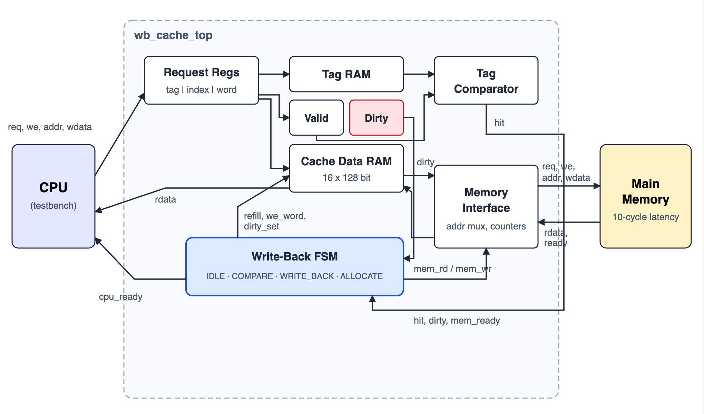
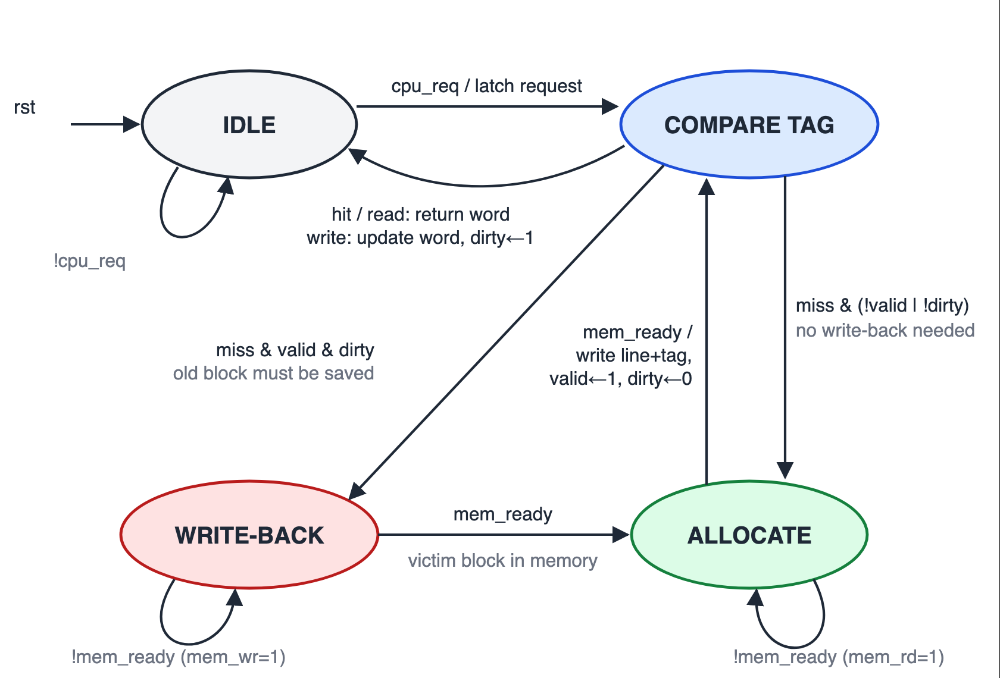
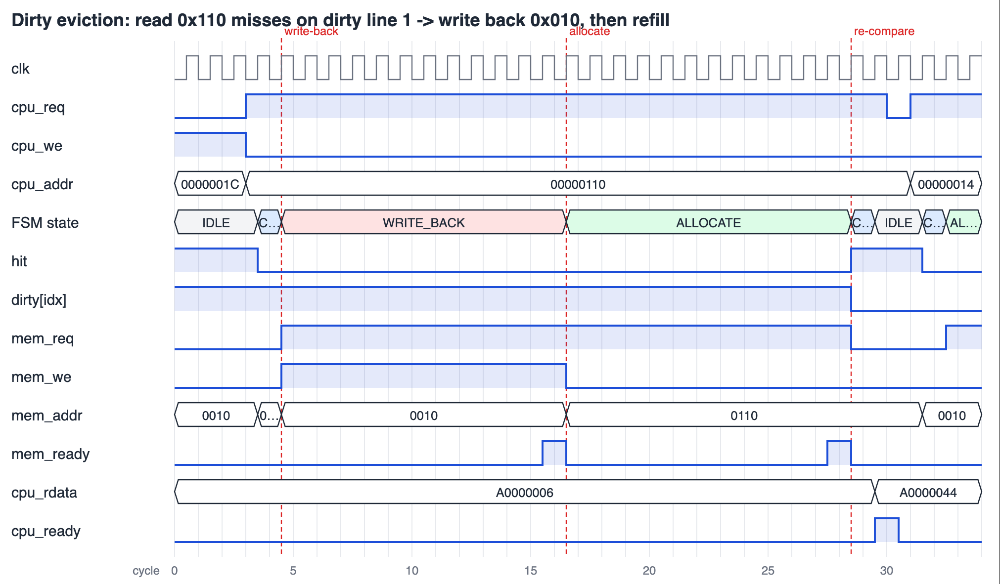
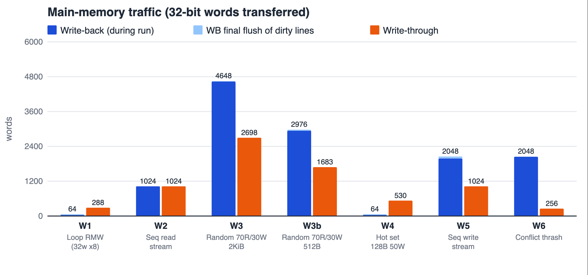

# Write-Back Cache Controller (Verilog HDL)

**Modern Computer Architecture – Project 8 (Advanced Intermediate)**
Phase I submission · **Group: Khel Khatam**

A direct-mapped **write-back, write-allocate** cache controller with dirty-bit
management. On a miss, a dirty victim is written back to memory before the new
block is refilled. The design is verified with a self-checking directed testbench
and compared against a write-through, no-write-allocate reference cache.

| | |
|---|---|
| 📄 IEEE report (PDF) | [`report/WriteBack_Cache_Phase1_IEEE_Report.pdf`](report/WriteBack_Cache_Phase1_IEEE_Report.pdf) |
| 📝 IEEE report (LaTeX, IEEEtran) | [`report/report.tex`](report/report.tex) |
| 🎬 Prototype demo video | **[ADD VIDEO LINK HERE]** |

## Team

| Member | Roll No. | Contribution |
|---|---|---|
| Pankaj Upadhyay | 2401010317 | Data RAM, Tag RAM, Valid RAM, Dirty-Bit RAM, Tag Comparator, `cache_params.vh` |
| Prakhar Rawat | 2401020045 | Write-back FSM (`wb_fsm.v`), state diagram, top-level integration |
| Harshit Kudhial | 2401010182 | Memory interface, main-memory model + traffic counters, write-through cache |
| Om Chimurkar | 2401010306 | Testbench, golden model, directed tests, coherence + FSM coverage, waveforms |
| Vishuti Jamwal | 2401010506 | Workloads, traffic analysis, figure scripts, literature review, report, video |

## Architecture

* 32-bit byte address, 16 lines × 16 B (4 words), direct-mapped (256 B of data)
* Address split: `tag[31:8] | index[7:4] | word[3:2] | byte[1:0]`
* Main memory: 128-bit block transfers, 10-cycle latency, `req/ready` handshake



### Controller FSM

| State | Action |
|---|---|
| `IDLE` | Wait for `cpu_req`, latch the request |
| `COMPARE` | Hit: read word, or write word and **set dirty**, then return to IDLE. Miss: go to `WRITE_BACK` if the victim is valid and dirty, else go to `ALLOCATE` |
| `WRITE_BACK` | Write the **old** block `{victim_tag, index}` to memory and wait for `mem_ready` |
| `ALLOCATE` | Read the new block. On `mem_ready`, write line and tag, **set valid, clear dirty**, then return to COMPARE |



## Repository layout

```
rtl/
  cache_params.vh     geometry (`define)
  cache_data_ram.v    Cache Data RAM
  tag_ram.v           Tag RAM
  valid_ram.v         Valid RAM
  dirty_ram.v         Dirty-Bit RAM
  tag_comparator.v    Tag Comparator
  wb_fsm.v            Write-Back controller FSM
  mem_interface.v     Memory Interface (address mux, burst counters)
  wb_cache_top.v      Write-back cache top level
  wt_cache_top.v      Write-through reference cache (for comparison)
  main_memory.v       Behavioural memory model with traffic counters
tb/tb_cache.v         Self-checking directed testbench + workloads
sim/run.sh            Compile + run (Icarus Verilog)
scripts/              Figure generation (VCD -> waveform SVG, CSV -> charts)
docs/figures/         Block diagram, FSM, waveforms, traffic/cycle charts
docs/tables/          Traffic summary table
report/               IEEE report (.tex, .html source, .pdf)
VIDEO_SCRIPT.md       5-minute demo video script
```

## How to run

Requires [Icarus Verilog](https://steveicarus.github.io/iverilog/) (≥ 11) and Python 3 (standard library only).

```bash
brew install icarus-verilog        # macOS  (Ubuntu: sudo apt install iverilog)
```

```bash
./sim/run.sh                       # compile + simulate -> sim/sim.log, sim/wb_cache.vcd, sim/traffic.csv
```

```bash
python3 scripts/make_figures.py    # regenerate waveform + chart SVGs from the simulation outputs
```

```bash
./sim/show_waves.sh                # run sim + open waveforms in Surfer (brew install surfer); key signals preloaded
```

## Verification results

```
checks=6494  errors=0  ->  ALL TESTS PASSED
transitions: IDLE>CMP=1 CMP>IDLE=1 CMP>WB=1 CMP>ALLOC=1 WB>ALLOC=1 ALLOC>CMP=1
```

Directed tests T0–T11 cover reset, read hit/miss, write hit (dirty set), repeated
writes (no traffic), dirty eviction (write-back **before** refill), clean
eviction, write miss on clean and dirty lines, a full 16-line dirty sweep, and
reset. Every read is checked against a golden model. After each test the
"cache + memory" view is also checked for coherence.



### Memory traffic: write-back vs write-through

| Workload | Acc. | WB words (incl. flush) | WT words | WB / WT | WB cycles | WT cycles |
|---|---|---|---|---|---|---|
| W1 Loop RMW (32 words × 8) | 512 | 64 | 288 | 0.22 | 1,128 | 4,200 |
| W2 Sequential read stream | 1,024 | 1,024 | 1,024 | 1.00 | 5,376 | 5,376 |
| W3 Random 70R/30W, 2 KiB | 1,000 | 4,648 | 2,698 | 1.72 | 16,769 | 13,411 |
| W3b Random 70R/30W, 512 B | 1,000 | 2,976 | 1,683 | 1.77 | 11,334 | 10,051 |
| W4 Hot set 128 B, 50 % writes | 1,000 | 64 | 530 | 0.12 | 2,104 | 8,080 |
| W5 Sequential write stream | 1,024 | 2,048 | 1,024 | 2.00 | 8,256 | 14,336 |
| W6 Conflict thrash | 256 | 2,048 | 256 | 8.00 | 6,900 | 3,584 |



Write-back cuts memory traffic by 78–88 % when stores have temporal locality.
It costs more traffic for streaming stores (fetch-on-write) and for conflict
thrash. These are the Phase II targets: write-validate with per-word dirty bits,
a write-back buffer, and 2-way associativity.
